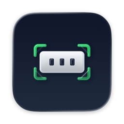

<p align="center"></p>

<h1 align="center">ALPR Gate</h1>

<p align="center">Offline license-plate recognition for gate access control — a local prototype.</p>

<p align="center">
  
  
  
  
  
  <a href="LICENSE"></a>
</p>

## What it is

ALPR Gate is a local, fully offline prototype of a license-plate-controlled gate. It reads a webcam feed, detects and reads
license plates, and shows **GRANTED** or **DENIED** depending on whether the plate is on an allowed list.

It is built with [Fast-ALPR](https://github.com/ankandrew/fast-alpr) (ONNX Runtime), OpenCV, PySide6 and a Rich terminal log.
It is developed and tested on macOS. It does not control any barrier or relay; it only shows the decision.

## Features

- Live webcam preview with plate detection overlays (green: allowed, red: readable but not allowed, yellow: detected but unreadable)
- Threaded pipeline: separate capture and inference threads keep the preview smooth
- Fuzzy plate matching that tolerates common OCR confusions (O/Q/D with 0, I/L with 1, Z with 2, S with 5, B with 8, G with 6)
- Minimum OCR confidence required before access is granted
- Allowed-plate list managed in the GUI and stored in a local `plates.json`
- Colored, timestamped terminal log with a periodic heartbeat (FPS, detections and allowed-list size)
- One-click cleanup of downloaded models and generated data
- Smoke test that runs the model stack against known-good images

## How it works

Capture and inference run in background threads. Matching and the final decision run in the GUI thread:

```
webcam ──► capture thread ──► latest raw frame ──► inference thread
                                                         │
                                                         ▼
                                    detector (YOLO v9, CPU) ──► OCR (ViT)
                                                                   │
                                                                   ▼
                                       matcher (normalize, fold, similarity)
                                                                   │
                                                                   ▼
                                     GUI decision: GRANTED / DENIED / WAITING
```

1. **Capture thread** reads frames from the default camera (requested at 1280×720) and keeps only the most recent one.
2. **Inference thread** copies the latest frame and runs Fast-ALPR, capped at 15 inferences per second.
   The detector always runs on the CPU. The OCR model uses CoreML on macOS or CUDA when available, and the CPU otherwise.
3. **Matcher** normalizes each read (uppercase, letters and digits only), folds visually ambiguous characters, and then
   compares it with each allowed plate. An exact or folded match wins at once. Otherwise the best similarity ratio must reach 0.85.
4. **Decision** in the GUI: a match with OCR confidence of at least 50% must appear on three consecutive UI refreshes
   before **GRANTED** is shown, and it stays for 3 seconds. A readable plate that does not match shows **DENIED**.
   A detected plate that OCR cannot read shows **WAITING**.

## Requirements

- Python 3.10+
- A webcam
- macOS camera permission for your terminal (System Settings → Privacy & Security → Camera)

## Installation

```bash
python3 -m venv .venv
source .venv/bin/activate
pip install -r requirements.txt
```

Dependencies: `fast-alpr`, `onnxruntime`, `opencv-python`, `numpy`, `PySide6` and `rich`.

## Usage

```bash
python main.py
```

The window has two panels. The camera preview is on the left. On the right are the status (GRANTED, DENIED, WAITING or ERROR),
the allowed-plate list and the controls.

On first run the two ONNX models (about 25 MB in total) are downloaded. After that everything runs offline.

### Environment variables

| Variable | Default | Effect |
| --- | --- | --- |
| `LOG_LEVEL` | `INFO` | Level of the terminal log. Use `DEBUG` for verbose output, which also logs each distinct plate read. Unknown values fall back to `INFO`. |

```bash
LOG_LEVEL=DEBUG python main.py
```

## Managing allowed plates

Use the right-hand panel of the GUI:

- Type a plate (for example `1234ABC`) and press **Add** or Enter. Spaces, dashes and other symbols are removed and letters are uppercased.
- Select one or more entries and press **Remove selected**.
- **Save current frame** writes the camera frame the detector is seeing to `debug-frame.jpg`, which is useful for diagnosis.

The list is stored in `plates.json` next to `main.py`. It is plain JSON, sorted and without duplicates:

```json
{
  "plates": [
    "1234ABC",
    "5678XYZ"
  ]
}
```

The file is ignored by Git. If it cannot be read or is not valid JSON, the app starts with an empty list, and the next change overwrites the file.

## Smoke test

To check the model stack independently of the webcam:

```bash
python smoketest.py
```

The script downloads a known-good test image (this needs network access on each run), runs the same detector and OCR models as the app,
and writes annotated images to `smoketest-out/`. It also checks `debug-frame.jpg` if you saved one. It finishes with a summary and exit code:

| Exit code | Meaning |
| --- | --- |
| `0` | The pipeline works. If only your webcam frame failed, the output says the detector has a blind spot on that input. |
| `1` | The model stack found nothing on a known-good image. The output lists likely causes. |
| `2` | No test ran, usually because the download failed. |

## Configuration

The tuning values are constants at the top of the listed files. Edit them there and restart the app.

| Setting | Value | File | Purpose |
| --- | --- | --- | --- |
| Detector model | `yolo-v9-t-640-license-plate-end2end` | `detector.py` | Finds plate regions |
| OCR model | `european-plates-mobile-vit-v2-model` | `detector.py` | Reads the characters |
| Detector confidence threshold | `0.1` | `detector.py` | Keeps weak detections so they can be debugged |
| Inference rate cap | 15 per second | `detector.py` | Keeps CPU use under control |
| Camera index | `0` | `gui.py` | Default webcam |
| Match similarity threshold | `0.85` | `matcher.py` | Minimum ratio for a fuzzy match |
| `STABILITY_FRAMES` | `3` | `gui.py` | Consecutive UI refreshes with the same match before GRANTED (each refresh is about 33 ms) |
| `GRANT_MIN_OCR_CONFIDENCE` | `0.5` | `gui.py` | Minimum OCR confidence to grant access |
| `DISPLAY_MIN_OCR_CONFIDENCE` | `0.25` | `gui.py` | Minimum OCR confidence to show a plate as readable |
| `GRANT_DISPLAY_SEC` | `3.0` | `gui.py` | How long GRANTED stays on screen |
| `DETECTION_FRESH_SEC` | `0.8` | `gui.py` | Maximum age of a detection shown as an overlay |
| Heartbeat interval | `8` seconds | `tui.py` | How often the terminal shows the status line |

OCR confidence is the lowest per-character confidence when the model reports one value per character.

## Privacy

- Everything runs on your machine. Frames are processed in memory.
- The models are downloaded once from the model hub used by Fast-ALPR and cached under `~/.cache/`. After that the pipeline runs offline.
- Allowed plates are stored only in the local `plates.json`, in plain text. Keep that file private.
- **Save current frame** and the smoke test write camera images to disk, which may show people or vehicles. Delete `debug-frame.jpg` and `smoketest-out/` when you no longer need them.

### Clearing data

The **Clear all data && quit** button at the bottom of the sidebar lists everything the app would delete, asks for confirmation,
stops the camera and inference threads, deletes the items and quits. It removes:

- the downloaded models in `~/.cache/open-image-models/` and `~/.cache/fast-plate-ocr/`
- `plates.json` (your allowed-plate list)
- `debug-frame.jpg`, `smoketest-out/`, `.cache/` and any `*.onnx` files in the project folder
- Python bytecode (`__pycache__`) inside the project, excluding virtual environments

It does not touch the virtual environment or installed packages.

## Project structure

```
alpr-gate/
├── main.py           Entry point: starts the Qt app and the terminal heartbeat
├── gui.py            PySide6 window: preview, plate manager, status and cleanup
├── detector.py       Capture and inference threads around Fast-ALPR
├── matcher.py        Plate normalization and fuzzy matching
├── storage.py        JSON-backed allowed-plate list (plates.json)
├── tui.py            Rich logging setup and the periodic heartbeat
├── cache.py          Inventory and removal of downloaded and generated files
├── smoketest.py      Model-stack check against known-good test images
├── requirements.txt  Python dependencies
├── assets/logo.png   Project logo
├── LICENSE           MIT license
└── .gitignore        Ignores venvs, caches, models, plates.json and diagnostic output
```

## Limitations

- This is a prototype and is not suitable as a security control. Plates can be spoofed, for example with a printed or on-screen image,
  and fuzzy matching can produce false positives.
- Recognition depends on lighting, distance and viewing angle. Test with the camera position you will use.
- The OCR model is trained on European plates, so accuracy on other formats may be lower.
- The app only displays the decision. Nothing is connected to a barrier, relay or door.
- The allowed list is stored unencrypted. There is no persistent access log; status changes are only printed to the terminal.

## Acknowledgements

- [Fast-ALPR](https://github.com/ankandrew/fast-alpr) by ankandrew, which provides the detection and OCR pipeline
- [ONNX Runtime](https://onnxruntime.ai/), [OpenCV](https://opencv.org/), [PySide6](https://doc.qt.io/qtforpython-6/) and [Rich](https://github.com/Textualize/rich)

## License

[MIT](LICENSE) © 2026 Pol Cabezas Agustí
